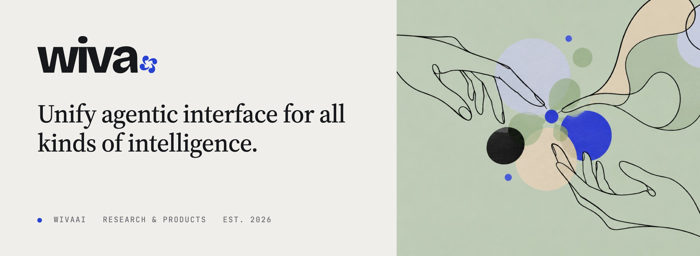
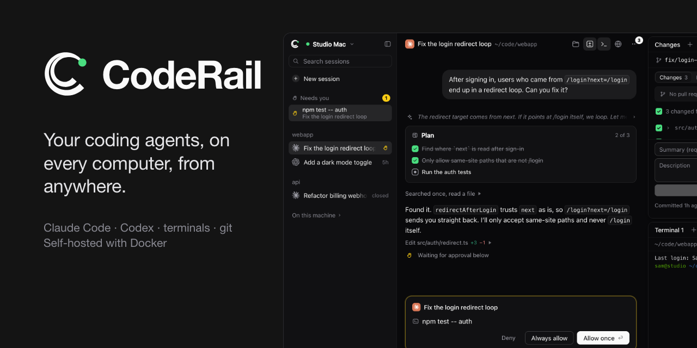

  <a href="https://wiva.io"><b>wiva.io</b></a> &nbsp;·&nbsp;
  <a href="https://x.com/wiva_hq">X</a> &nbsp;·&nbsp;
  <a href="mailto:hello@wiva.io">hello@wiva.io</a> &nbsp;·&nbsp;
  <a href="https://wiva.io/#updates">Updates</a>

Intelligence is no longer a single thing. It is the judgment of people, the persistence of agents, the breadth of
models and the reliability of tools. **WivaAI builds the systems that let them work from the same context:** openly,
accountably, and with people holding the final say.

## Open source

<table>
  <tr>
    <td width="52%" valign="middle">
      
    </td>
    <td valign="middle">
      <picture>
        <source media="(prefers-color-scheme: dark)" srcset="assets/coderail-mark-dark.svg">
        
      </picture>
      <h3><a href="https://github.com/wiva-hq/CodeRail">CodeRail</a></h3>
      
Self-hosted remote control for your coding agents: Claude Code and Codex chats, approvals, terminals, files,
      git and dev-server previews for every computer you own, from the browser or your phone.

      
One Docker container on your own server. Agents propose; you approve, from anywhere.

      

        <a href="https://github.com/wiva-hq/CodeRail"><b>Repository</b></a> ·
        <a href="https://docs.coderail.codes">Docs</a> ·
        <a href="https://github.com/wiva-hq/CodeRail/releases">Releases</a> ·
        <a href="https://coderail.codes">coderail.codes</a>
      

    </td>
  </tr>
</table>
